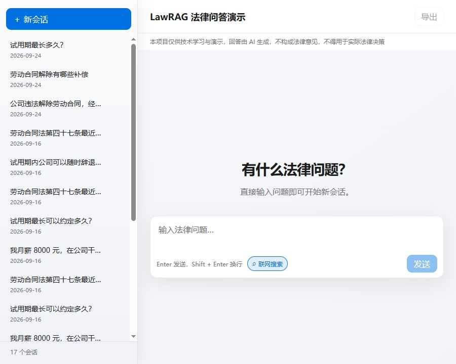
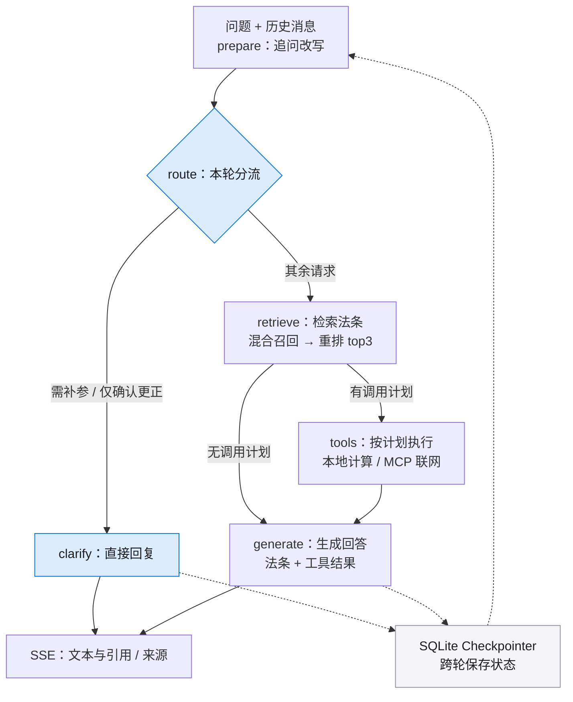

# LawRAG

**基于法律原文的多轮问答助手。** 结合混合检索、工具调用与会话状态管理，为劳动和消费维权问题提供带法条引用的回答。

[](https://github.com/JackGitLab/LawRAG-public/actions/workflows/tests.yml)
[](requirements.txt)
[](LICENSE)

[效果示例](#效果示例) · [数据流](#数据流) · [快速开始](#快速开始) · [工具与 MCP](#工具与-mcp) · [评测结果](#评测结果与验证)



*LawRAG Web 界面：支持历史会话管理与可选联网搜索。*

- **有据可查**：向量与 BM25 混合召回、重排，回答附带法律名称、条号及来源。
- **连续追问**：SSE 流式输出，SQLite 保存会话；前端支持历史切换、删除及浅色 / 深色主题。
- **按需用工具**：计算器支持补参、更正与取消；联网开关控制法规时效核验和通用搜索。
- **可验证的工程过程**：冻结题集、检索策略对照、调用观测，以及针对真实问题的回归测试。

> 本项目用于技术学习与演示，AI 回答不构成法律意见，不用于实际法律决策。

## 效果示例

以下示例摘自已保存的历史运行记录，展示一次完整的检索与回答过程；原始运行档案未随公开仓库发布。

**提问**

```powershell
.\.venv\Scripts\python.exe -m app.ask "劳动合同到期，公司不续签，有经济补偿吗？"
```

**检索法条**

| 法律 | 条文 | 相关度 |
| --- | --- | ---: |
| 中华人民共和国劳动合同法 | 第四十六条 | 0.8348 |
| 中华人民共和国劳动合同法 | 第九十七条 | 0.8260 |
| 中华人民共和国劳动合同法 | 第四十七条 | 0.7932 |

**生成回答**

> 劳动合同到期，公司不续签，是否有经济补偿，需区分两种情形：
>
> 1. 如果公司维持或者提高劳动合同约定条件续订劳动合同，而劳动者不同意续订的，用人单位无需支付经济补偿（第四十六条第五项）。
>
> 2. 除上述情形外，因劳动合同期满终止固定期限劳动合同的，用人单位应当向劳动者支付经济补偿（第四十六条第五项）。
>
> 经济补偿的计算标准为：按劳动者在本单位工作的年限，每满一年支付一个月工资；六个月以上不满一年的，按一年计算；不满六个月的，支付半个月工资（第四十七条）。劳动者月工资高于用人单位所在直辖市、设区的市级人民政府公布的本地区上年度职工月平均工资三倍的，按职工月平均工资三倍的数额支付，且支付年限最高不超过十二年（第四十七条）。月工资是指劳动者在劳动合同解除或者终止前十二个月的平均工资（第四十七条）。
>
> 此外，本法施行之日存续的劳动合同在本法施行后终止，依照第四十六条规定应当支付经济补偿的，经济补偿年限自本法施行之日起计算；本法施行前按照当时有关规定用人单位应当支付经济补偿的，按照当时有关规定执行（第九十七条）。

**返回引用**：第四十六条、第九十七条、第四十七条。相关度用于候选排序，不是法律结论的置信度；第九十七条的排序偏高也是当前检索仍可改进的例子。

## 数据流

多轮问答先判断本轮任务，再决定是否检索和调用工具；缺参追问直接返回。单轮 `/api/ask` 使用独立的检索与生成入口。



实线表示本轮执行路径；虚线表示图执行过程保存状态，并供后续轮次读取。确定性追问同样通过 SSE 返回文本，引用列表可为空。

**检索如何产生依据？**

问题经 `bge-m3` 向量化后从 Chroma 召回 10 条；同一法条集合通过 jieba 分词与 BM25 再召回 10 条。RRF 按两路名次融合、去重并保留 10 条候选，`bge-reranker-v2-m3` 重新评分后返回 top3。语料按法条切分，保留法律名称、条号等元数据，供回答引用。向量化与重排通过 SiliconFlow 调用。

**路由如何判断？**

计算关键词、待补任务或已有任务的取消 / 重试意图触发计算规划；模型从本轮原话提参，代码再核验数值归属、有效性与已有状态。缺少有效工资或年限时追问；参数齐全且确需计算时才生成调用计划。联网分支由开关与时效关键词决定，不交给模型任意选择工具。

详细设计见 [DESIGN](docs/DESIGN.md)，多轮补参、更正与任务切换见 [多轮计算说明](docs/STAGE2_CLARIFICATION.md)。

## 快速开始

下面是 **Windows / PowerShell** 路径，需要 Python 3.13、Node.js / npm 和 Git。已验证的软件版本、Docker 运行方式及排错说明见 [ENVIRONMENT](docs/ENVIRONMENT.md)。

### 1. 获取项目并安装依赖

```powershell
git clone https://github.com/JackGitLab/LawRAG-public.git
cd LawRAG-public
py -3.13 -m venv .venv
.\.venv\Scripts\python.exe -m pip install -r requirements.txt
npm.cmd --prefix frontend ci
```

公开仓库可直接克隆。无需激活虚拟环境，后续统一使用显式解释器路径。

### 2. 配置当前终端的环境变量

| 变量 | 用途 |
| --- | --- |
| `DEEPSEEK_API_KEY` | 生成与工具路由 |
| `SILICONFLOW_API_KEY` | 向量化与重排 |
| `BOCHA_API_KEY` | 可选；开启联网搜索时使用 |

通过本机安全的环境配置方式设置这些变量，确保启动服务的终端能够读取。本项目不使用 `.env`；不要把密钥写入仓库、截图或日志。可选模型与 Langfuse 配置见[环境说明](docs/ENVIRONMENT.md#2-外部服务与凭据)。

```powershell
.\.venv\Scripts\python.exe check_env.py
```

### 3. 建立索引、构建前端并启动

首次入库与问答会调用外部服务，可能产生费用。

```powershell
.\.venv\Scripts\python.exe -m app.ingest
npm.cmd --prefix frontend run build
.\.venv\Scripts\python.exe -m uvicorn app.main:app --reload
```

打开 <http://127.0.0.1:8000>。必须先构建前端，再启动后端；更新语料后重新入库并重启服务。生成的索引、数据库和前端构建文件不进入 Git。

<details>
<summary>开发模式与命令行</summary>

前端开发模式：后端运行时，在另一个终端执行 `npm.cmd --prefix frontend run dev`，访问 <http://localhost:5173>。Vite 将 `/api` 代理到本地后端。

命令行提问：

```powershell
.\.venv\Scripts\python.exe -m app.ask "劳动合同到期，公司不续签，有经济补偿吗？"
```

</details>

## 工具与 MCP

| 工具 | 何时调用 | 执行方式 |
| --- | --- | --- |
| 法定赔偿 / 补偿计算器 | 参数齐全，且本轮需要计算或明确重试 | 进程内确定性函数，支持 N / N+1 / 2N |
| 法规时效核验 | 开启联网，并命中修订、废止、现行有效等时效关键词 | MCP client → stdio 薄 server → 博查 API |
| 通用联网搜索 | 开启联网，且未命中时效关键词 | 同一 MCP 接入链路 |

每轮最多执行一轮已规划的工具，再将结果交给生成节点；没有工具计划则直接生成。计算任务支持补参、更正、取消与新任务隔离，执行失败不会记为计算完成。联网失败或资料不足会明确传入生成上下文。

LawRAG 同时是 **MCP client** 和 **MCP server**：前者消费博查能力，后者通过 FastApiMCP 将问答与会话接口提供给外部客户端。对外端点为 `http://127.0.0.1:8000/mcp`（streamable HTTP），白名单工具为 `ask_law_question`、`chat_law_question`、`list_sessions`、`get_session` 和 `delete_session`。

```json
{
  "mcpServers": {
    "lawrag": {
      "url": "http://127.0.0.1:8000/mcp"
    }
  }
}
```

## HTTP 接口

| 接口 | 用途 |
| --- | --- |
| `POST /api/ask` | 无会话状态的单轮问答，返回 `answer` 与 `citations` |
| `POST /api/chat` | 多轮问答；首次只传问题，后续携带返回的 `session_id` |
| `POST /api/chat/stream` | SSE 多轮问答：`session → token → done`；流内失败返回 `error` |
| `GET /api/sessions` | 列出会话 |
| `GET /api/sessions/{session_id}` | 读取会话消息及引用 |
| `DELETE /api/sessions/{session_id}` | 删除会话元数据及对应 Checkpointer 状态 |

多轮响应包含法条 `citations` 与可选联网 `web_sources`；完整请求字段与响应结构见本地接口文档 <http://127.0.0.1:8000/docs>。

## 技术栈与分工

| 组件 | 项目中的职责 |
| --- | --- |
| Vue 3 + Vite | 流式对话、会话管理与引用展示 |
| FastAPI + fastapi-mcp | HTTP / SSE 接口与对外 MCP 工具 |
| LangGraph + SQLite Checkpointer | 多轮编排、消息及计算任务状态持久化 |
| LlamaIndex + Chroma | 法条节点、向量索引与检索 |
| jieba + rank-bm25 | 中文分词与关键词召回 |
| SiliconFlow | `bge-m3` 向量化、`bge-reranker-v2-m3` 重排 |
| DeepSeek | `deepseek-chat` 追问改写与生成；`deepseek-flash` 计算工具提参 |
| Langfuse（可选） | 模型调用链追踪；本地性能观测另以 JSONL 保存 |

## 项目结构

```text
app/
├── main.py             # FastAPI、SSE 与对外 MCP
├── graph.py            # 多轮状态、路由、工具执行与生成
├── ask.py              # 检索策略、重排与单轮问答
├── ingest.py           # 法律文本读取、按条切分与入库
├── tools.py            # 本地补偿计算器
├── mcp_tools.py        # 外部工具客户端与结果处理
├── mcp_bocha_server.py # 博查 MCP stdio 服务
├── db.py               # SQLite 会话与 Checkpointer 连接
├── config.py           # 模型、环境变量与索引配置
└── observability.py    # 调用追踪与性能记录
frontend/               # Vue 页面与前端逻辑测试
kb/                     # 两部法律的 DOCX 语料
tests/                  # 冻结题集、回归测试与评测 CLI
scripts/                # 测试入口与本地档案检查工具
docs/                   # 成果、设计、环境与精选复盘
outputs/                # 保留的采集入口、价格快照及核验依赖
.github/workflows/      # GitHub Actions 测试
```

运行生成的索引、数据库、构建产物和原始日志不进入 Git。完整过程档案保留本地，精选案例见 [工程复盘](docs/ENGINEERING_NOTES.md)。

## 评测结果与验证

| 项目 | 观察结果 | 样本与口径 |
| --- | --- | --- |
| 检索策略对比 | Hit@3：**42/45 → 45/45** | 修订版固定题集，纯向量与 hybrid_rerank；衡量目标法条覆盖 |
| 路由优化 | 检索调用 **24 → 20** | 优化前后各 24 个请求；LLM 逻辑调用仍为 36 → 36 |
| 缺参追问首段响应 | 中位数 **5.28s → 3.68s** | 两批各 3 次正式样本，确定性追问首段，非模型 TTFT |

检索题集含 45 道库内题和 10 道库外题；另有 40 个冻结场景覆盖回答质量、工具路由与多轮任务。评测绑定题集和答案内容身份，避免答案变化后沿用旧评分；其中 4 道法律标注题仍待复核。

固定题集命中率不等于法律回答正确率。耗时仅为两批小样本观察，其他场景也有变慢，不能外推为稳定收益或总费用下降。对照数据、样本范围与历史证据见 [成果与验证](docs/RESULTS.md)。

```powershell
# 离线 Python 回归
.\.venv\Scripts\python.exe scripts\run_tests.py tests -q

# 冻结题集校验
.\.venv\Scripts\python.exe tests\run_quality_evaluation.py validate

# 前端逻辑测试
node --test frontend/test/*.test.mjs
```

## 已知局限

- 知识库仅含劳动合同法与消费者权益保护法两部法律，覆盖范围有限。
- 当前为本地演示项目，无公网演示服务和账户鉴权；外部服务额度、网络与索引状态会影响运行。
- 一个会话只管理一个待办计算任务，不支持多个计算任务并行处理。

本仓库是独立公开快照，保留应用源码、测试与历史结果摘要；私人开发记录、原始日志和旧提交历史不随仓库发布。结果范围见 [成果与验证](docs/RESULTS.md)。

## 深入阅读

| 文档 | 内容 |
| --- | --- |
| [成果与验证](docs/RESULTS.md) | 指标口径、样本与历史证据 |
| [设计与取舍](docs/DESIGN.md) | 检索策略、Agent 与 MCP 的设计选择 |
| [精选工程复盘](docs/ENGINEERING_NOTES.md) | 评分身份、多轮参数隔离与清理状态真实性 |
| [运行环境](docs/ENVIRONMENT.md) | 依赖、服务、语料、Docker 与排错 |
| [评测方法](docs/EVALUATION.md) / [性能测量](docs/PERFORMANCE.md) | 冻结题集与可复算的测量方法 |

项目采用 AI 协作开发，协作与验证约定见 [AGENTS.md](AGENTS.md)。

## License

[MIT](LICENSE)
